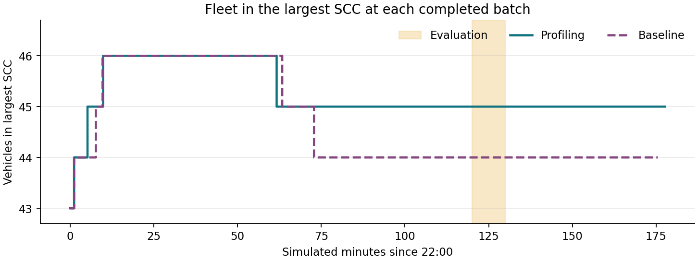
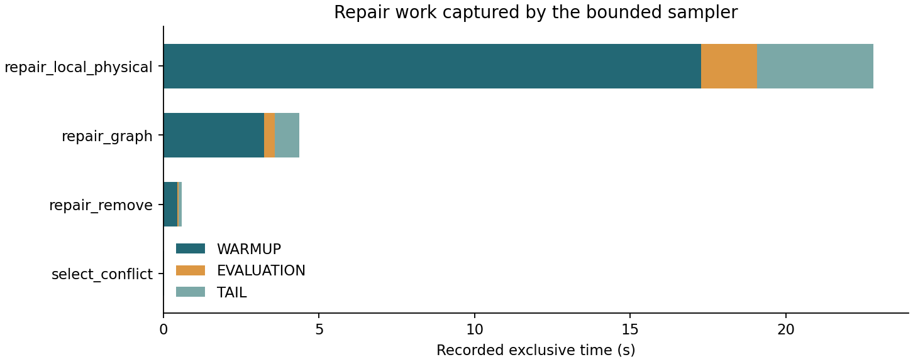

# P6 真实 E10 Profiling 结果与车辆强连通分量审计

**本次 E10 的功能与统计闭合成立。** 用户手动运行的 Profiling 实验（下称 P）为 `COMPLETE`，终态审计 `PASS`。按原始请求时刻重建的评价集合为 187 条，其中 39 条合法接受并完成，服务率 **20.8556%**。高负载下最值得优化的是删除冲突请求以后重复做的分量物理解码。确有车辆因送客驶出主 SCC 后无法返回，但两次 E10 的主 SCC 车辆数均先升后降，最终高于初值。长期流失的速率、采样开关对服务率的净影响以及缓冲路网能恢复多少车辆，仍需独立证据。

## 实验身份与独立闭合

P 为 `outputs/20261121T151519Z-1ccd3331b2fa425e99cbfafde128809e`，对照 B 为 `outputs/20261121T095345Z-f4ee53eccb874218bbe3fa3ced6fcb2f`。两次均使用同一组 50 车初始节点、187 个评价 ID、P0 三份样本及路网、固定航空网络、车队和 HALNS 种子 101。原始 TLC/OSM 哈希按归档 manifest 对照，三份已处理样本和道路文件另从文件重算。两次使用同一 Windows、ridesharing Python 3.9.25、Gurobi 12.0.3、10 秒 Wall Budget 和逐批独立验证。解析有效 YAML 后，仅 P 新增 profiling 节。D004–D007、D010–D014 仍是本次事件、搜索、再平衡和统计的审查依据。

| 身份 | B | P |
|---|---|---|
| Git HEAD（两次工作区均含未提交内容） | `5ea69b8f4564270395341f977d213ef4f6753dee` | 同左 |
| src Python 指纹 | `b313b62d931c87e931d8d12894d0ac1b2eee582d1812cd290bb15edbdda30ed4` | `96376675654f4d8209362d9fcd3ab9ce3bad4f663f1ef724021a8b1642523f23`，与本次读取的源码一致 |
| 有效配置 SHA256 | `2b181ea778591718c217994315dcabab6647c0083f5fefa2b52b5e9d324d2bbb` | `bee9c30e4fc5efcc9f7143d8b66707cbd9c0ee6558b6e6ec2bb93749c9125c16` |
| 结果校验 | manifest 之外 10/10 文件大小及 SHA256 匹配 | manifest 之外 11/11 匹配，含 profiling.jsonl |

独立读入 P0 请求、事件 gzip、航班订座、请求与批次 CSV，对照 manifest、summary、audit、performance 和控制台。按原始请求秒应用半开区间 [00:00, 00:10)，验证唯一 ID、资源绑定顺序、接客与终达时限、占座及座位数、固定航班起降、道路逐边连续性及每批事件数。两次每个批次的累计到达减去接受和过期等于 pending，累计接受减去完成等于在服。P 的逐请求复算如下。[复算脚本](../analysis/p6_profile_real10/closure.py) · [两次完整闭合结果](../analysis/p6_profile_real10/closure.json)

| P 原始到达归属 | 到达 | 接受且完成 | 过期 | SHRS / MHRS / RS-UAM | 完整出行 / 等待 / 有符号绕行均值，分钟 |
|---|---:|---:|---:|---:|---:|
| WARMUP | 2490 | 605 | 1885 | 340 / 5 / 260 | 13.295 / 5.559 / +4.398 |
| EVALUATION | 187 | 39 | 148 | 18 / 0 / 21 | 14.658 / 5.402 / +4.567 |
| TAIL | 516 | 123 | 393 | 58 / 2 / 63 | 14.061 / 5.666 / +4.839 |
| 全部 | 3193 | 767 | 2426 | 416 / 7 / 344 | 13.487 / 5.568 / +4.477 |

P 写入 80,578 条事件，其中 60,139 条道路边完成，778 次地面接客与 778 次送达，354 对步行开始/结束。4,020 个固定航班实例中，3,600 班在运行范围内起飞，3,563 班已落地；434 个有乘客的班次全部落地，488 个乘客航空段共占 697 座，占起飞容量 14,400 的 4.84%。未落地的空班符合停止规则。评价阶段最后一个批次累计接受/完成为 39/0；评价请求在模拟秒 9442 全部终结。此前已进入系统的需求继续排空，最后时刻为 00:57:40，pending=0、在服=0、空闲=50。

## 相同需求下，搜索轨迹从何处分开

| 批次阶段 | 批数 B / P | M4 用尽 B / P | M5 无法落实 B / P | 整批 >10 s B / P | 每秒完成候选 B / P |
|---|---:|---:|---:|---:|---:|
| WARMUP | 720 / 720 | 707 / 707 | 713 / 713 | 708 / 708 | 11.36 / 11.33 |
| EVALUATION | 60 / 60 | 60 / 60 | 60 / 60 | 60 / 60 | 4.80 / 5.21 |
| TAIL | 274 / 287 | 176 / 180 | 158 / 165 | 176 / 180 | 96.84 / 115.53 |
| 全程 | 1054 / 1067 | 943 / 947 | 931 / 938 | 944 / 948 | 28.02 / 32.34 |

吞吐为完成候选总数除以该段 M4 搜索墙钟总秒数。P 的三个阶段分别用去批次墙钟 8,287.53 / 690.54 / 2,242.21 秒。全程 M4 占 9,705.84 / 11,220.28 秒（86.50%），整批 P50/P95/P99/最大为 10.940 / 15.367 / 17.592 / 19.793 秒。P 的 M5 状态为 938 次 UNEXECUTABLE、127 次 SKIPPED、2 次 READY，合计发布 10 辆。两次尾部活跃请求、时长及负载不同，尾部吞吐不能用来估计诊断开销。

逐批首次差异依次出现在第 13 批的完成候选数、第 19 批的批内 best_score、第 26 批的新增接受数。首个候选数分歧发生在未抽样批。运行速度、诊断观测和墙钟检查点均可影响后续随机抽签次数与资源可用状态，单对轨迹无法识别各自贡献。相同 187 条中，两次都完成 25 条、仅 B 完成 20 条、仅 P 完成 14 条、两次都过期 128 条；净差 −6 条或 −3.2086 个百分点。P 的评价期候选吞吐甚至略高。该对照支持比较负载现象和功能结果，不能据此估计开启 Profiling 将损失多少服务率。[逐请求配对](../analysis/p6_profile_real10/evaluation_pairs.csv)





## M4 时间、修复与请求采样

输入为本次运行的 `profiling.jsonl`、`batches.csv`、`requests.csv`、`manifest.json`。离线脚本为 `timing.py`，解释器为 `D:/Programs_D/Anaconda/envs/ridesharing/python.exe`，Python 3.9.25。依据 D003–D006 及论文 §5.3.2–5.3.5、Algorithm 4。预算边界亦见 §6.2、Table 5 与项目已批准的 M4 单模块墙钟口径。

### 覆盖与时间归属

1,067 批中每十批从首批起记录一次，实际 107 批（72 预热、6 评价、29 尾部），文件 495,633 字节，文件限额未丢行。每个选中批从第 1 个候选 S1 起，每隔 32 个候选取一个，最多 8 个。30,454 个已开始候选中 321 个被选，29,454 个因步长跳过，679 个因每批上限跳过。13 批达到 8 个，12 批实际超限。共记录 46,368 个细分 span，64 批达到 512 个，63 批实际省去 19,749 个。序列化和写盘另计 64.935 ms。明细在 `timing_sampling.csv`。每批上限使后段候选几乎没有代表性，步长始终纳入 S1。采样批对应模拟时刻每 100 秒一次，分钟内只覆盖 0、20、40 秒三个位置。

`timing_stages.csv` 及 `timing_stages_by_phase.csv` 给出 25 个实际出现阶段的调用数、含子调用及扣除已计时子调用的总毫秒数、均值、P50/P95/P99/最大值和次数加权的均次耗时。分位数以**该阶段有记录的批次**为单位，对一批内全部所计调用累计毫秒取线性分位。全程、各期分别统计，零观测的阶段保留零次、零总量和空分位。原件没有逐调用时间，无法恢复单次调用的分位数。后续候选、算子、图与物理调用使用各自采样规则，原始记录只有每批各阶段的汇总，无法再按 S1/后续拆分某个子阶段。首次算子生成也会单独计时。完整解码 noD 专属阶段和独立 `operator_scope_graph` 在本运行没有记录。

| 已计时阶段 | 调用数 | 含子调用合计 s | 扣已计时子调用合计 s | 每个有记录批的含子调用 P50 / P95 / P99 / 最大 ms |
|---|---:|---:|---:|---:|
| S0 构建 | 107 | 13.942 | 0.043 | 155.45 / 224.84 / 265.12 / 269.09 |
| S1 解码 | 107 | 25.512 | 1.622 | 196.12 / 611.50 / 764.63 / 1002.84 |
| 后续候选解码 | 214 | 18.473 | 11.538 | 224.89 / 470.64 / 543.85 / 592.18 |
| 初始分量物理计算 | 2,299 | 1.924 | 1.924 | 11.16 / 48.84 / 69.66 / 82.12 |
| 删除后分量物理计算 | 12,641 | 22.800 | 22.800 | 200.29 / 535.52 / 674.46 / 870.51 |
| 删除后受影响分量重建 | 10,288 | 4.367 | 4.367 | 43.68 / 108.98 / 133.73 / 147.39 |
| 选择冲突 | 10,331 | 0.021 | 0.021 | 0.21 / 0.27 / 0.30 / 0.35 |
| 删除编码 | 10,296 | 0.594 | 0.594 | 6.50 / 7.46 / 8.02 / 8.45 |
| 最终独立校验（预算外） | 107 | 9.605 | 9.605 | 85.25 / 165.22 / 214.30 / 215.95 |

S0 准备固定承诺计 9.275 s，回放计 4.624 s。被观察的修复工作主要耗在删除之后重新计算物理时序，其次是重建图。三个阶段的修复后局部物理分别为 17.263 / 1.810 / 3.726 s（预热 / 评价 / 尾部）；各期采样数量不同。后续候选包络自身 11.538 s 包括分量查表、未单列逻辑以及被截去的子调用；无法从此数识别其中某个函数的成本。预算内已计时的 exclusive 仅合计 59.081 s，占对应 107 批 M4 的 969.862 s 约 6.09%。禁止把 measured share 外推为全搜索热点比例或预期加速比。全批终检 94.893 s；每批一次终检发生在预算结束后。乘客提交、再平衡发布也在 M4 外。

### 预算、候选与缓存

| 阶段 | 批数 | 预算耗尽 | 超时且选 S0 | 已启动 / 已完成 | 完成候选/搜索秒¹ | 每批完成候选 P50 | 删除/完成候选¹ |
|---|---:|---:|---:|---:|---:|---:|---:|
| 预热 | 720 | 707 | 249 | 81,308 / 80,602 | 11.33 | 57 | 29.22 |
| 评价 | 60 | 60 | 26 | 3,187 / 3,127 | 5.21 | 47 | 56.52 |
| 尾部 | 287 | 180 | 79 | 230,380 / 230,201 | 115.53 | 91 | 2.53 |

¹ 比值使用该期分子与分母之和；尾部含 122 个关闭进件批次，其中删除次数中位数为零。尾部仍开放的 165 批全部耗尽预算，完成候选中位数 56，删除中位数 3,561。各期工作量、需求和候选组成不同。每批最大细采样和截断见 `timing_phase_work.csv`。

全程完成 313,930 个候选，31,228 个完整候选判不可行。全程 `decode_count` 3,428,528 = S0 1,067 + 完成候选 313,930 + 删除 3,113,531。删除原因依次为接客窗 2,944,288（94.56%）、道路不可达 109,154、误航班 48,784、送达窗 10,795、车辆容量 478、航班容量 32。每批删除次数 P50/P95/P99/最大为 3,058 / 4,460.2 / 7,447.9 / 12,615；完成候选对应为 63 / 1,401 / 5,201.78 / 5,751。合计比为 9.92 次删除/完成候选，而逐批计算该比值的中位数为 52.27，P95 为 109.92，最大 125.57。分母多的轻负载批对合计比影响很大。日志没有逐候选修复直方图、逐检查点剩余预算或 best 轨迹，无法求出“有多少候选删除超过 N 个请求”、每种冲突耗时、被截断候选原可否改善提交结果。相同请求可反复被候选删除。终止性冲突与普通删除分开统计，分别是送达窗 17,389、接客窗 6,814、车辆容量 6,544、误航班 481。

947 个耗尽预算批中，593 批保留了优于 S0 的可行 best，354 批返回 S0，592 批实际新增接受。开始与完成候选之差为 945，另 2 个耗尽批发生在两者数量相等时。实现只在可行候选严格提分时替换 best，在预算异常后保留 best 并独立验证。可核对提交状态、S0 对象身份、源码保最佳规则；日志不足以重新按分数穷举复核每批最佳。Type3 与安全基线的工作不能因超时直接略过。

完成候选累计重算 4,566,959 次、复用 70,308,234 次分量结果，复用占 93.90%。实现的键包含当前批解码器、保留约定时刻开关、该分量全部请求的选择以及任务序列（批通过解码器实例隔离）；相邻候选与同一候选修复中均可能复用，本次汇总无法分拆。9,935,760 个候选终态分量大小观测中 86.06% 为 0–4 个任务，最大 34；最终 best 的单批最大分量中位 11、最大 23。道路 distance/path 计数为共享路由器累计值，末行分别 196,310,681 命中 / 569,717 未中（99.71%），110,092 / 31,527（77.74%），无法用这些计数直接估算 M4 的未中耗时。107 个采样批七算子实际生成次数中 restart 20,503/30,347；直接记录的 restart 生成计 236 次、0.705 s。缺少算子与后续解码、修复的逐候选连接键，无法用生成阶段时长比较各算子完整成本或收益。

### 请求×批次证据

107 个采样批中，95 批各选 3 个 Type1/2 等待请求，另 12 批无符合条件的请求；10,353 个等待请求×批次中选 285 个，273 个唯一 ID。结果见 `timing_requests.csv`、`timing_request_groups.csv`。这是一批最多 3 个的确定性抽样，负载高的批次抽样比例较小，滞留请求可重复出现。按批次阶段为预热 216、评价 18、尾部 51；按请求原始 cohort 为预热 224、评价 17、尾部 44。18 个评价批内观测含 8 个预热请求，另有 7 个评价请求在尾部抽中。17 个评价请求各出现一次，15 个标为尝试中断、2 个逐段资源不全。

| 本批 outcome | 观测数 | 去重 ID（类间可重叠） | 本批预算耗尽 | 已完成编码中因冲突删除的次数 | 最终完成的观测数 |
|---|---:|---:|---:|---:|---:|
| accepted | 5 | 5 | 2 | 91 | 5 |
| feasible_trial_not_selected | 1 | 1 | 1 | 75 | 0 |
| interrupted_attempt | 224 | 219 | 224 | 8,264 | 0 |
| removed_in_observed_trials | 17 | 17 | 14 | 1,653 | 0 |
| no_complete_binding_options | 38 | 38 | 38 | 0 | 0 |
| trial_infeasible / not_attempted | 各 0 | 0 | 0 | 0 | 0 |

285 次全部有 M1 方案，38 次逐段运力不全（请求年龄 280–420 s，中位 400 s）。247 次至少一套方案每个正式腿有资源，全部被尝试，也均在至少一个已完成解码中被删除过。逐段有资源只说明存在各腿选项，联合时序、容量、跨段和既有承诺仍由 M4 判定。247 次观测总计参与候选 10,997 次，完成 10,770 次，合法保留 687 次（涉及 6 条观测），冲突删除 10,083 次。一次本批未选请求曾合法保留 18 次。224 个“中断”观测中，首个已记录冲突为接客窗 214、不可达 10；这 224 个也都曾在已经完成的候选被删除。全部 285 次的首冲突分布为接客窗 236、不可达 10、误航班 1、无记录 38；5 个最终接受的观测也都有过首冲突。固定标签的优先级会遮蔽同时发生的事件。抽中请求的尝试计数覆盖相应采样批的全部候选，独立于 321 个候选的计时抽样。现有证据支持逐阶段定位，不能给 148 个未服务评价请求分配唯一根因、推算延长预算后的救回数量或把 224 次中断直接计为服务损失。

### 能单独辨识的候选成本

逐候选平均删除数可由全程计数相除；全体候选的 P95、最大值不能由批汇总恢复。有一个小子集允许直接比较同一入口 `s1_decode`。19 批只有 S1 被详细计时且内层记录完整，均观测到删除。另有 6 批全批无删除、无非法候选且搜索正常完成。以下分位以单个 S1 为单位，耗时为完整解码 inclusive。两组输入规模严重不同：无冲突组全在收尾，Type1/2 为零，只有 2–15 条 Type3。观测差距不能解释为单次接客冲突的净开销，也不能推断其余候选的分布。[提取条件与脚本](../analysis/p6_profile_real10/s1_comparison.py) · [逐样本数据](../analysis/p6_profile_real10/s1_comparison.csv)

| 可辨识 S1 | 数量 | 删除次数均值 / P95 / 最大 | 解码毫秒均值 / P50 / P95 / 最大 |
|---|---:|---:|---:|
| 有完整修复记录 | 19 | 104.74 / 117 / 117 | 403.21 / 342.71 / 661.01 / 711.68 |
| 无冲突批 | 6 | 0 / 0 / 0 | 6.22 / 6.24 / 7.24 / 7.33 |

在 107 个采样批，七算子的实际生成次数 / 计时次数 / 已记录生成毫秒总数分别为 p_exchange 2750/58/3.079，v_exchange 2350/43/1.632，restart 20503/236/705.302，insert 1175/27/1.670，cut 1350/41/4.929，swap 1244/32/3.328，reverse 975/25/2.603。生成之外的解码成本另计。任务图初建计 298 次、416.407 ms，合并计 215 次、703.880 ms，继承剩余序列计 106 次、194.323 ms，S1 构造计 107 次、237.109 ms；107 批的乘客事务共 878.580 ms，再平衡提交或跳过处理共 0.987 ms。`operator_scope_graph` 仅在相应序列算子、作用域变化且抽中细采样时才会计时，缺行无法判定实际成本为零。叶阶段 inclusive 等于 exclusive。父阶段只扣除其**实际计时的直接子调用**，截断后尚未归类的子调用时间会保留在父阶段 exclusive。[全程函数表](../analysis/p6_profile_real10/timing_stages.csv) · [三个阶段逐函数调用、总量、分位数](../analysis/p6_profile_real10/timing_stages_by_phase.csv) · [采样覆盖](../analysis/p6_profile_real10/timing_phase_work.csv)

## 两次完整 E10 的有向路网与车辆轨迹

本节使用已归档 baseline（095345Z）和 profiling（151519Z）各自的 manifest、请求、批次和物理事件。D011 批准完整 Manhattan 有向图，D004 保留不可中断当前边，D010 将 M5 网格流落实为可行道路移动（论文 §5.4 算法 5）。两份 manifest 的道路 SHA-256 均与实际 roads.json 一致。按分量大小降序、并列按最小节点 ID 排序，核心标为 SCC 0（16,808 节点），全图共有 1,905 个强连通分量。

### 逐车逐批还原

在 SCC 凝聚有向无环图上，核心的祖先为上游，后代为下游；其余分量与核心在两个方向上都没有路径。初始四辆受限车的节点全部属于核心后代，均可由核心驶达，但均无法驶回核心。

| 相对核心的位置 | SCC 数 | 节点数 | 两次初始车数 | baseline 最终车数 | profiling 最终车数 |
|---|---:|---:|---:|---:|---:|
| 核心 | 1 | 16,808 | 43 | 44 | 45 |
| 上游 | 1,009 | 1,010 | 3 | 0 | 0 |
| 下游 | 882 | 882 | 4 | 6 | 5 |
| 其他 | 13 | 13 | 0 | 0 | 0 |

从 50 个初始节点出发，顺序读取 EDGE_END，核对每条边存在、起点等于上条已完成边终点，结合 physical_time 和 duration_s 还原物理区间。每批记录上一个已完成节点的分量，抵达终点才计作迁移。在途另列 source/target SCC 和不可中断边走完后的可用分量。统计在途使用左闭右开区间；恰在批时刻开始的边已计为在途。这一后验位置口径可能包含该时刻提交启动的动作，不能解释成 M4 提交前的快照。

| 运行 | 批数 × 50 | 边完成 | 同 SCC 边在途车批 | 跨 SCC 边在途车批 | 节点车批 | 核心车数按连续批次 |
|---|---:|---:|---:|---:|---:|---|
| baseline | 52,700 | 58,413 | 37,720 | 22 | 14,958 | 1–7 批 43；8–46 批 44；47–58 批 45；59–380 批 46；381–437 批 45；438–1054 批 44 |
| profiling | 53,350 | 60,139 | 38,376 | 20 | 14,954 | 1–7 批 43；8–31 批 44；32–59 批 45；60–370 批 46；371–1067 批 45 |

两次从相同的 43 核心内、7 核心外初始位置开始。核心外三辆沿单向道路空驶接客进入核心，其余四辆的初始节点无法到达核心。两次运行所有进出核心事件均发生在预热段；评价阶段每批 baseline 为 44 辆在核心、profiling 为 45 辆。

| 运行 | 车辆 | 首次进入 / 离开核心的整秒 | 记录的移动用途及实际后续服务 |
|---|---|---:|---|
| 两次 | V00038 | 进入 69 | 空驶接客，均于 141 s 接 485151 |
| baseline / profiling | V00001 | 进入 459 / 309 | 空驶接客，下次实际接 488530（2431 s）/ 486640（1179 s） |
| baseline / profiling | V00040 | 进入 578 / 588 | 空驶接客，下次实际接 488732（666 s）/ 489097（734 s） |
| baseline | V00014 | 离开 3793 | 载 514337，3832 s 于节点 1701898716 下客，之后零接客；从该节点仅可达 5 节点（含本节点） |
| baseline | V00023 | 离开 4363 | 载 518307，4380 s 于节点 246906179 下客，之后零接客；从该节点仅可达 52 节点 |
| profiling | V00012 | 离开 3694 | 载 514337，3733 s 于节点 1701898716 下客，之后零接客 |

记录了上客后实际车上请求，以及空驶时的下一次实际接客。后者的任务有可能在随后批次中被调整。baseline 共有 99 条跨分量边（59 空驶接客、40 载客），profiling 有 94 条（59、35），均无 M5 再平衡跨分量边。多条连续小分量边只对应一次离开或进入核心。回到核心在凝聚图上不可达；服务完外部落点后，两次均未观测到这些车辆在下游接受新单。

表内整秒是事件执行秒，等于物理到达时刻向上取整。实际出核边的物理终点时刻为 baseline 3792.7857223799555124 s、4362.99831537827036144 s，以及 profiling 3693.7857223799555124 s。其余跨分量边的两个时刻在 scc_crossings.csv 中逐边列出。

### 四辆受限车辆与 M5

| 初始车辆 | 所在节点 | 可达节点（含本节点） | baseline 失败诊断出现批数 | profiling 失败诊断出现批数 |
|---|---:|---:|---:|---:|
| V00021 | 3786728574 | 53 | 162 | 349 |
| V00022 | 371239965 | 51 | 162 | 349 |
| V00027 | 4149993889 | 49 | 715 | 522 |
| V00030 | 4158737898 | 53 | 54 | 67 |

四车在两次运行始终停在初始节点，道路边完成、上客、下客均为零。每次被列入失败记录时，该车对所列目标格所有 entry_nodes 的可达入口数为零，reachable_options 中也没有该车。baseline 的 931 个失败批次（预热 713、评价 60、后续 158），profiling 的 938 个（713、60、165），均有至少一辆这类车。按拓扑阻断车辆集合去重计批，baseline 为仅 V00027 共 266 批、仅 V00030 共 54 批、V00021 与 V00022 共 162 批、V00023 与 V00027 共 449 批；profiling 为仅 V00027 共 522 批、仅 V00030 共 67 批、V00021 与 V00022 共 349 批。baseline 后 449 批的 V00023 是服务订单后停于外部的另一辆车，包含评价的全部 60 个失败批次。该关联能说明已选网格流在指定源格中的具体车辆为何受阻，无法据此计算更换车队或修改 M5 后的服务率增益。

### 原始请求 OD 与车辆移动

两个评价窗都收入相同 187 个唯一请求。185 个起终点都在核心，其余 2 个为外部起点、核心终点，均过期未服务。baseline 45 个完成、profiling 39 个完成，其原始 OD 都在核心。全运行 baseline 3,167 个请求中实际完成 2 个核心到外部请求（514337、518307），profiling 3,193 个中完成 1 个（514337，518307 过期）。这些均为预热订单。三辆实际从外向内进核的车是在执行空驶接客；该方向没有已完成的外部起点订单。原始订单 OD、载乘客的实际服务段和车辆空驶分别从 requests.csv、已执行上下客事件及道路边用途取证。

按凝聚图方向复核全部进入运行的唯一请求，baseline / profiling 分别有 3,155 / 3,181 个核心内 OD，均有 10 个上游到核心 OD、2 个核心到下游 OD，下游起点订单均为 0。这解释了初始下游四车无法到达日志中任何原始上车点；接驳段的接客地点须按实际方案单独核对。全程实际下游上客也为 0。

### 可复核产物

同目录 scc_audit.py 从两次 gzip 事件流逐行读取，每辆车仅留查找批时位置所需的边区间和实际服务记录。scc_positions.csv 为 106,050 条车批位置，scc_batches.csv 给出每批两种核心数和在途数，scc_crossings.csv 给出每条跨分量边，scc_episodes.csv 给出每次实际上下客与该请求原始 OD 分量。scc_fleet.csv、scc_m5_mentions.csv、scc_request_od.csv 和 scc_summary.json 分别给出逐车、每条 M5 失败记录中的逐车入口可达性、请求分组及全程汇总。解释器 D:/Programs_D/Anaconda/envs/ridesharing/python.exe，Python 3.9.25、NetworkX 3.2.1。脚本通过 60 s 超时包装执行，仅审计归档文件。

## 路网边界、最大强连通分量与运营可达性

### 当前口径与分母

D011 和《DATA_AND_PROTOCOL》批准完整行政区有向图，正式入口按该图检查有向 OD。P0 在 relation 8398124 内保留边界覆盖的节点，只保留相邻原始 OSM 引用均被保留且符合可行车、方向条件的边（src/data/p0.py、src/network/road.py）。全图 18,713 节点 / 26,461 条有向边，同属一个弱连通分量，分为 1,905 个强连通分量。最大 SCC 有 16,808 节点 / 24,491 条边（89.82% / 92.56%），裁剪会移去 1,905 节点 / 1,970 条边。

P0 评价时段清洗至映射前剩 672,989 条候选，若按最大 SCC 重吸附则 4,233 条改变端点，其中 1,687 条原映射 OD 不可达，余 2,546 条原可达。4,233 不是正式评价样本的改点数。全时段映射前 1,084,915 条候选有 6,746 条改点，其中 2,707 条原不可达。正式按原可达性过滤后分层抽样；重新纳入旧图不可达请求并重新抽样会改变分母。以下固定原样本 ID 比较。原始 TLC 经纬度、正式图和产物均未修改。

| 固定请求集 | 总数 | O 改点 | D 改点 | 至少一端改点 |
|---|---:|---:|---:|---:|
| 正式 WARMUP | 2,490 | 7 | 2 | 9 |
| 正式 EVALUATION | 33,565 | 91 | 33 | 124 |
| 正式 TAIL | 18,055 | 47 | 25 | 72 |
| 正式三份合计 | 54,110 | 145 | 60 | 205 |
| 本次运行 WARMUP / E10 / TAIL | 2,490 / 187 / 516 | 7 / 2 / 1 | 2 / 0 / 0 | 9 / 2 / 1 |
| 本次运行全部记录 | 3,193 | 10 | 2 | 12 |

所有行原映射 OD 都可达；三份正式样本共 53,905 条可直接保留两个原节点，205 条若保留 ID 并切换到最大 SCC，则须重新吸附一个端点，节点级均可完成重吸附。若要求复用原节点 ID，205 条无法原样进入裁剪图。后者不代表应排除这些需求。尚无经批准的乘客误差门槛或逐个路侧、楼层、上下匝道/步行入口核验，因此无法从距离推定任何一条必须剔除或现场可以上下客。最近节点规则本身不创造步行时间。

### 距离和有向行程

吸附距离为原始经纬度至节点的大圆距离（m）。正式三份改点的 145 个 O / 60 个 D，新误差中位数 21.50 / 24.60，p95 63.05 / 59.72，最大 133.40 / 93.91；误差**增量**中位数 8.13 / 9.33，p95 33.52 / 48.77，最大 115.87 / 76.85。正式评价所有端点新误差 O / D 的 p50 为 19.44 / 23.32、p95 为 59.66 / 76.70、最大为 265.48 / 406.41；本次 E10 分别为 21.32 / 21.95、61.58 / 74.67、95.11 / 149.98。全口径逐端点、原新、改点子集及增量的均值/中位/p95/p99/最大见 network_snap.csv。

每条请求按较差端点统计超距，两端取最大值。以下为描述性敏感性（超过表列距离的请求数，旧→新），未把阈值写入过滤逻辑。

| 请求集 | >50 m | >100 m | >250 m | >500 m |
|---|---:|---:|---:|---:|
| 正式三份 | 11,894→11,908 | 1,306→1,309 | 3→3 | 0→0 |
| 正式评价 | 7,274→7,282 | 800→800 | 3→3 | 0→0 |
| 本次 E10 | 38→38 | 5→5 | 0→0 | 0→0 |

正式评价请求 735779 的 D 误差从 17.05 增至 93.91 m，有向最短路从 1,671.65 缩至 811.52 m；1058720 的 D 误差仅从 4.10 增至 12.40 m，最短路却从 5,029.81 缩至 3,963.08 m。本次 E10 的 559015 起点误差 12.75→18.62 m，最短路 1,520.30→1,526.19 m；559408 起点误差 2.20→10.86 m，最短路 2,804.99→3,237.16 m。几米的吸附变化即可切换单向道路的接入位置。这些路径以保存边长最短路独立计算；两个新端点均在同一 SCC，连接它们的有向路不能出 SCC 后又返回，故在完整图上求其长度等价于在诱导子图上求。

10 个起降场的道路节点及吸附距离全部相同（9.57–107.28 m）。50 个初始车位置中 43 个在最大 SCC，7 个须挪动（8.98–53.38 m）。其中 V00021 / 22 / 27 / 30 从原始位置向前分别只能到 53 / 51 / 49 / 53 个节点（含自身），V00001 / 38 / 40 可向前到 17,697 / 17,705 / 17,774 个。单纯属于小 SCC 不能证明车辆出不去。按现有 place_fleet 的有放回均匀抽样复核 seed=101 与 manifest 的 50 个初始节点逐车相同；同一种子在 SCC 排序节点重抽，50 个初始位置全部改变。对照实验须说明是匹配地理位置还是在新的运营域重新抽车。

### 行政边界截断证据

从低正向可达初始车的终点及距行政边界最近的 40 个有向源/汇取证，定向读取本地 PBF 的对应 way 标签、原始相邻节点引用与坐标。18 对已缺失的相邻点均由原边界 polygon covers 确认为区外，见 network_boundary_adjacent.csv。终点数与截断比例不能从这个定向样本外推。

| 已保存区内节点 | 原始 way 与设施 | 相邻区外节点 | 正式图表现 |
|---|---|---|---|
| 4150144218 | 5681925，Hugh L. Carey Tunnel，单行隧道 | 4150144210 | V00027 可达的汇，入 1 出 0，距边界 0.82 m |
| 371239964 | 32965216，Willis Avenue Bridge，单向桥 | 5525663526 | 入 1 出 0，距边界 12.79 m |
| 371225096 | 46240263，motorway_link，bridge=yes，单向匝道 | 3786728803 | 入 1 出 0，距边界 3.24 m |

V00021/22 可到达 way 46240262/46240265 的高架单行匝道汇；V00030 可到达 Brooklyn Bridge way 432550257 的汇。这几个汇在已留存 way 上没有发现缺失的相邻引用，须检查其他相接 way、方向和接入规则才可归因。对已证实截断的路段，有限缓冲能否接回正确方向的返回路径仍取决于覆盖范围。两地虽近也不能人工加反向边或认定有合法掉头位。

### 两种数据实例及决策

**A · 仅在最大 SCC 运营。** 所有初始车、请求、站点、M5 入口与运营格候选都落在新图后，任意两节点之间有有向路径，能消除纯粹因无路造成的格入口失败。匹配数量、承诺、时窗、路上不能中断、目标为空或规划预算仍分别约束实际执行。该政策适于定义可往返的核心服务区，用于受控对照成本低；会移除真实单向可服务道路，重吸附近距离也可能改变直达时长、窗口、服务方案和评价基准。单独把车撒在 SCC、保留原请求与格中心不足以保证全域两两可达。复现主线继续使用 D011；不以提高服务率为选择图的依据。

**B · 需求域保持 Manhattan，路由域允许真实外围连接。** 对允许车辆出区绕行再入区的真实运营语义，应优先评估该方案。需求经纬度仍按原行政区筛选，明定起终点、站点、初始车、可选入口、格中心是否限区内，区外节点可仅作在途通行。保留 OSM 单行、合法转向/车型通行限制的可验证范围；P0 现有节点边模型并未建立完整转向限制。只加任意固定宽缓冲不能保证跨河匝道可形成回路；应检查关键桥/隧两岸出入口与合法返回路径，并报告仍不可达者。可能恢复原路，也可能引入更短的区外绕行；道路基准、候选、时间窗、航段接驳、再平衡、网格及运行成本皆可能改变。当前没有构建缓冲图，恢复比例、服务率及耗时均未实测。

两者均涉及更改 D011 的正式数据实例，需要用户另行选择和授权。建议先冻结请求 ID/坐标、固定航站/航线、车容量与初始地理位置，做离线拓扑和误差对照，逐个查改点和残余断点；若另测重新清洗/抽样或重放运营结果，要独立报告分母、图版本、起始位置和预算。A 适合问“限制在互通核心会怎样”，B 适合问“允许真实出区通行是否恢复这些道路”，本次证据无法给出服务率收益。

复核环境为 Conda ridesharing，D:/Programs_D/Anaconda/envs/ridesharing/python.exe，Python 3.9.25。离线分析入口为 python -B -m analysis.p6_profile_real10.network 与 python -B -m analysis.p6_profile_real10.network_boundary（依次执行）。只读正式数据并写分析 CSV，未运行仿真或生成新的 P0 图。

## 决策与优先级

**48 小时风险有实际轨迹依据。** 在固定图、固定车队且没有外部调入时，“仍有路径到达核心”的车辆数只能持平或减少。它包含尚未入核的上游车。P 从 46 降至 45，B 从 46 降至 44。直接盘点核心内车辆则分别从 43 经 46 到 45 和 44。两次的全部出核都发生在预热；观察期没有持续下降的斜率。两次均无下游起点的原始请求；两辆或一辆出核车完成手上的送客后均未在下游再接客。48 小时能否进一步累积，取决于后来是否继续接受需要核心车前往下游的任务，以及下游能否就地服务。此次观测不能估计损失的 48 小时总量。建议较长窗同时报告「核心内」「仍能回核心」「下游新增接客」三条序列。[逐批盘点](../analysis/p6_profile_real10/scc_batches.csv) · [跨边事件](../analysis/p6_profile_real10/scc_crossings.csv) · [订单 OD](../analysis/p6_profile_real10/scc_request_od.csv)

1. **P6 基线验收优先保留可比性。** E10 没有显示需要在原配置 E11 前强制修复的调度正确性错误。如果目的是验收 D011 基线，E11 应由用户手动运行原 30 分钟验证配置，独立检查 SHA256、按原始时刻的分母、接受等于完成、任务/座位/道路事件与终态闭合。无需先改变路网或 M5，profiling 配置仅供诊断。P6 完整 Gate 仍待 E11 及用户审查。48 小时正式实验还需先明确采用哪一版图和服务域，保留 E11 的分阶段吞吐及累计历史规模证据，并由用户决定可接受的计算时间；开放尾期与关闭进件后的吞吐不可混为一谈。
2. **优先试验语义不变的 M4 工程优化。** 在固定快照、编码、修复顺序和候选数的微型对照中，优先测 `PartitionedDecoder._local → FullDecoder._physical`。检查每次删除后为同一分量收集资源、选取请求、构造局部状态的重复分配；对确认只读且版本固定的数据试验复用。其次测 `TaskGraph.from_tasks` 处理受影响分量，以及未变分量的缓存键、查表与容器复制成本。当前已经只重建受影响组，不能把它描述为每次重建全图。禁止跨快照复用预约、在途边和乘客就绪状态；回归应比较完整/分量解码的任务序、首冲突、修复顺序、资源、时刻和分数，再做固定工作量吞吐比较。真实墙钟预算下提速也会改变探索轨迹。此项可独立于 E11 排期。
3. **若要解释单候选长尾，先增加最小证据。** 只对已选中的候选保存批内序号、S1/算子、完成/中断、修复次数、首冲突与 inclusive 解码纳秒；预算内只累加，维持按批记录与总文件上限。可以据此求采样候选的 P95 和最大值，并在相似任务规模内比较。全候选分布需额外的定长内存直方图。既有 94% 左右的缓存复用率说明命中真实存在，尚无同工作量禁用复用的实测加速比。当前证据不足以调整预算、删减候选或改变修复次序。
4. **M5 改进需要单独决策。** 对照应分开测试网格流增加真实可达性约束、失败后重新求流、以及改变整份发布规则。前两项改变 D010/论文网格运输问题的可行域或求解流程；部分发布还改变原子承诺、流量闭合及车队下一批状态。四辆车与全部 P 失败批相关只证明已记录的局部阻塞。B 的固定流全局最大匹配结论归属旧审计，本轮没有把它复制为 P 的独立全局证明。新增模型不得并入复现基线。
5. **道路方案另立数据实例。** 吸附误差、路程变化、初始车位以及原始桥隧跨边均有实证，足以支持 A/B 离线敏感性研究。如果研究目标是恢复实际出区后回到 Manhattan 的车行路径，优先验证方案 B；方案 A 提供较容易构造的封闭服务区对照。先逐个验证合法去回路径、站点和订单吸附，再考虑运行任何调度实验。固定原图、原样本与原种子的基线应继续可复核。[固定样本改点](../analysis/p6_profile_real10/network_counts.csv) · [距离阈值敏感性](../analysis/p6_profile_real10/network_sensitivity.csv) · [原始 OSM 断点](../analysis/p6_profile_real10/network_boundary_adjacent.csv)

### 本轮验证与交付

所有新增文件在本报告及 `analysis/p6_profile_real10/`。该目录的 closure、timing、s1_comparison、scc_audit、network、network_boundary、figures 脚本分别对应结果闭合、计时/请求、可辨识 S1 子集、车辆流动、重吸附、边界原始证据和两幅图。正文数值来自已有运行文件。只读复算复用了旧 E10 的请求与事件审计函数，未执行旧 M5 全批最大匹配。用现有解释器 `D:/Programs_D/Anaconda/envs/ridesharing/python.exe` 运行以下人工回归，**4 passed in 2.84s**。适用范围为固定工作量 RNG/快照、嵌套时钟及超时保优。本轮没有修改调度或路网，也没有启动真实仿真。

```powershell
python -B -m pytest -p no:cacheprovider -q tests/integration/test_p6_profiling.py::test_profiling_preserves_rng_work_best_and_snapshot tests/integration/test_p6_profiling.py::test_profiled_timeout_keeps_completed_improvement tests/integration/test_p6_profiling.py::test_exclusive_timing_counts_only_direct_children
```
